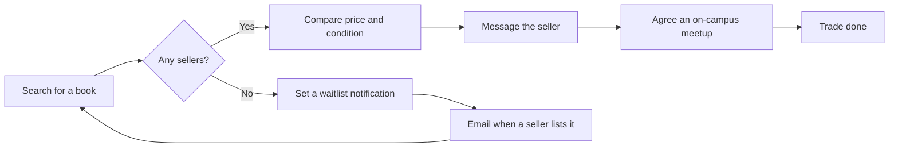

# Getting Started

Welcome to UniBooks! This guide walks you through the basics.

---

## What Is UniBooks?

UniBooks is a **second-hand textbook search and matching platform** built for university students in Taiwan. It is organised around ISBNs: every seller of the same book appears on a single page, so you can search, compare prices, get in touch and complete the trade in one place.

---

## No Sign-in Needed to Browse

You can browse and search every book without registering or signing in. You only need an account when you want to **list a book for sale**, **message a seller** or **set a waitlist notification**.

---

## Creating an Account

1. Go to the UniBooks home page and choose "Sign up".
2. Enter your name, email and a password. **Any email address works**, or create the account with your **Google** account instead.
3. We send an activation link to your inbox. Click it to activate the account, then sign in.
4. In "Account settings", verify your **`.edu.tw` school email**. Once that is done you can list books and message sellers.

> **Note**: UniBooks is for current college and university students. You must verify your school email before listing or contacting sellers, and re-verify it after each semester starts to confirm you are still enrolled.

---

## Ways to Sign In

You can sign in with any of these:

- **Email and password**: if you forget your password, choose "Forgot password?" on the sign-in page. We send a reset link to your inbox, valid for 1 hour.
- **Google**: choose "Continue with Google". UniBooks receives only your email address, name and avatar and never touches other Google data.
- **A passkey**: sign in with your fingerprint, face or screen lock, with no password to type. Sign in once, open "Passkeys" in Account settings and choose "Add a passkey". After that, click the email field on the sign-in page; your browser lists your passkey and you just pick it.

When you sign in, sign up or ask for a password-reset link, UniBooks first checks that you are a person (Cloudflare Turnstile). Usually this finishes in the background and you see nothing; a checkbox appears only when you need to do something.

> If you have added a passkey or linked a Google account, you can remove your password in "Account settings" and sign in with those only.

---

## How It Works

---

## Next Steps

- Read about the [trading process](/en/guide/transactions)
- Read about the [waitlist](/en/guide/waitlist)
