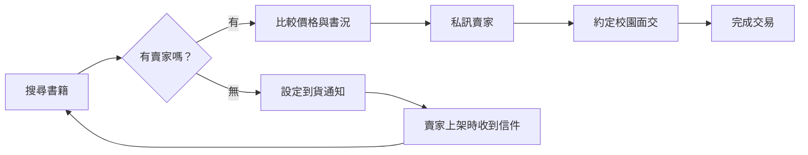

# 新手上路

歡迎使用 UniBooks！本篇指南將帶你快速了解平台的基本使用方式。

---

## UniBooks 是什麼？

UniBooks 是專為台灣大專院校學生打造的**二手教科書搜尋與媒合平台**。我們以 ISBN 為核心，將同一本書的所有賣家聚合在一個頁面上，讓你一站搜尋、比價、聯繫、完成交易。

---

## 不需登入就能使用

你可以直接瀏覽、搜尋所有書籍，完全不需要註冊或登入。只有當你想**刊登販售**、**私訊賣家**或**設定到貨通知**時，才需要建立帳號。

---

## 建立帳號

1. 前往 UniBooks 首頁，點擊「註冊」
2. 輸入你的姓名、電子郵件與密碼；**任何信箱都能註冊**。你也可以改用 **Google 帳號**直接建立
3. 系統會寄一封啟用連結到你的信箱，點擊連結啟用帳號後即可登入
4. 登入後到「帳號設定」驗證你的 **`.edu.tw` 學校信箱**，完成後即可刊登書籍、私訊賣家

> **注意**：本平台限大專院校在學學生使用。要刊登與聯繫賣家必須先驗證學校信箱，且每學期開學後需重新驗證以確認在學身份。

---

## 登入方式

你可以用下列任一種方式登入：

- **信箱與密碼**：忘記密碼時，在登入頁點「忘記密碼？」，我們會寄重設連結到你的信箱，1 小時內有效。
- **Google 帳號**：點「使用 Google 登入」。UniBooks 只取得你的電子郵件、姓名與頭像，不會存取其他 Google 資料。
- **通行密鑰（passkey）**：用指紋、臉部辨識或螢幕鎖定登入，不必輸入密碼。先登入一次，到「帳號設定」的「通行密鑰」點「新增通行密鑰」；之後在登入頁點一下信箱欄位，瀏覽器會列出你的通行密鑰，選取它即可。

登入、註冊與申請重設密碼時，系統會先確認你是真人（Cloudflare Turnstile）。多數情況下會在背景自動完成，看不到任何畫面；只有需要你操作時才會跳出勾選框。

> 已新增通行密鑰或綁定 Google 帳號的話，可以在「帳號設定」移除密碼，之後只用這些方式登入。

---

## 平台首頁

登入後的首頁提供以下功能入口：

- **搜尋列**：輸入 ISBN、書名或課堂名稱，即時搜尋書籍
- **到貨通知**：想買的書尚無刊登？點擊「通知我」，上架時到提醒
- **我的刊登**：查看與管理你上架的書籍
- **我的訊息**：查看與買/賣家的聊天記錄
- **我的訂閱**：管理所有已訂閱的到貨通知

---

## 核心運作方式

---

## 下一步

- 了解如何[搜尋書籍](/guide/search)
- 了解如何[刊登販售](/guide/listing)
- 了解[交易流程](/guide/transactions)細節
- 了解[到貨通知](/guide/waitlist)機制